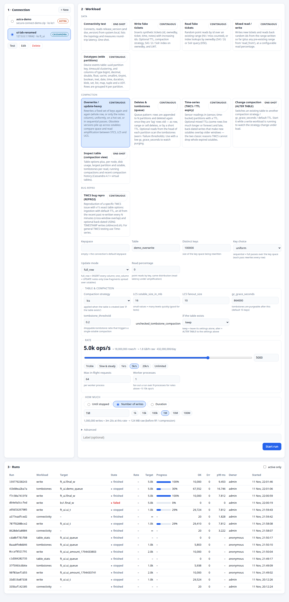
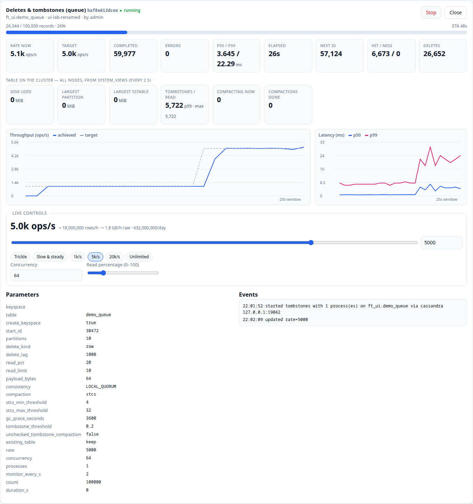

# fake-tickets v2

> ⚠️ Test / reproduction tool. Workloads deliberately include anti-patterns. Don't
> point it at production clusters.

The original `fake-tickets` data simulator, rebuilt as a **long-running,
Kubernetes-friendly service**. You open a web page, pick or create a database
connection (Cassandra, DSE or Astra, with SCB upload), choose a workload, and set
the insert rate with a slider. You can start, retune and stop runs live, and
several users can run workloads at the same time, each run in its own process.

```
Browser ─HTTPS─► frontend (UI · login · encrypted connection vault) ─HTTPS+token─► backend (run manager)
                                                                                     ├─ run a1b2 (process) ─CQL─► Cassandra/DSE
                                                                                     └─ run c3d4 (2 processes) ─CQL─► Astra
```

The original scripts (v1) are kept on branch `v1` / tag `v1.0`; their notes are in
[`docs/v1/`](docs/v1/).

Design docs: [v1 spec](docs/01-EXISTING-SPECIFICATIONS.md) ·
[requirements](docs/01b-V2-REQUIREMENTS.md) ·
[HLD](docs/02-HLD.md) · [LLD](docs/03-LLD.md).





## Workloads

| Workload | What it does |
|---|---|
| **Connectivity test** | `release_version` / `dse_version`, topology, keyspaces, round-trip latency (v1's version check) |
| **Write fake tickets** | v1 ticket rows at a target rate. Options: STCS/LCS/UCS/TWCS, TTL (none / table default / per row), index on `ownedby` (SAI / 2i / Solr), LWT, payload padding |
| **Read fake tickets** | random point reads over the written id range (hit/miss), or index / Solr lookups by owner |
| **Mixed read / write** | writes plus reads of what was written, with a *live* read-% slider |
| **Datatypes** | wide partitions with collections, UDT, tuple, uuid/timeuuid, decimal, varint, inet, date/time, duration, blob |
| *Compaction* | |
| **Overwrite / update-heavy** | rewrites a fixed key space (uniform, hot set, or sequential passes; whole row or one column) — obsolete versions across sstables, space and read amplification |
| **Deletes & tombstones (queue)** | append + delete `lag` rows behind as row / range / cell deletes or TTL; optional reads from the partition head that scan the tombstones |
| **Time-series (TWCS / TTL expiry)** | sensor time-series with TTL; optional mixed TTLs and late (back-dated) writes that make new sstables overlap older windows — the two things that stop TWCS dropping expired sstables |
| **Change compaction (ALTER TABLE)** | one-shot switch of strategy / gc_grace / default TTL, e.g. while another run keeps writing |
| **Inspect table** | one-shot: options + per-node disk usage, largest partition & sstable, tombstones per read, running and recent compactions |
| *Bug repro* | |
| **TWCS bug repro (REPRO2)** | v1's exact TWCS options; overlap rewrites every N **minutes of wall clock**; optional back-dated `USING TIMESTAMP` writes (v1's `oldrecord.sh`) |

Every table-creating workload takes the same **compaction options**: STCS / LCS /
UCS / TWCS with their sub-options (thresholds, LCS sstable size & fanout, UCS
`scaling_parameters` & target size, TWCS window unit/size & timestamp resolution),
`gc_grace_seconds`, `tombstone_threshold`, `unchecked_tombstone_compaction`, and
what to do if the table already exists (keep with a warning, or `ALTER`).

Every continuous run takes a **rate** (1 → 100 000+ ops/s, or unlimited), an
in-flight cap, **how much**: until stopped, a **number of records** (`250k`, `1.5M`…,
with time and volume estimates, a progress bar and an ETA) or a duration, and
`processes` to fan out beyond what one Python process can push (~5–8 k ops/s).
Reads and deletes never count towards the number of records. An optional
**compaction monitor** (Cassandra 4.1+) shows disk usage, largest partition and
sstable, tombstones per read and compactions (running, finished, bytes in → out)
on the run page.
`start_id = -1` resumes after the last id written to that table through that
connection, which replaces v1's increment file.

## Quick start

### Local (venv)
```bash
python3 -m venv .venv && .venv/bin/pip install -e '.[test]'
FT_DATA_DIR=./.data FT_BACKEND_TOKEN=dev .venv/bin/faketickets backend &
FT_DATA_DIR=./.data FT_BACKEND_TOKEN=dev FT_PORT=8443 .venv/bin/faketickets frontend
# open http://localhost:8443
```

### Containers
```bash
podman build -t localhost/fake-tickets:2.0.0 .
podman build --target test -t localhost/fake-tickets:test .      # runs the test-suite in the image
FT_MASTER_KEY=$(openssl rand -base64 32) FT_BACKEND_TOKEN=$(openssl rand -hex 24) podman compose up
# UI: http://localhost:8443 → New connection → host "cassandra", port 9042, RF 1
```

### Kubernetes
```bash
# 1. push the image somewhere your cluster can pull from, then set it in deploy/k8s/base/kustomization.yaml
# 2. fill deploy/k8s/base/secret.yaml (FT_MASTER_KEY, FT_BACKEND_TOKEN) — or use SealedSecrets
kubectl apply -k deploy/k8s/base                 # plain HTTP inside the cluster, no login
kubectl apply -k deploy/k8s/overlays/homelab     # step-issuer certs, HTTPS everywhere, LDAP login, Ingress
```
The backend is a single replica on purpose: runs live in its process tree. When
it restarts, runs that were active show as `interrupted`, and the next run on
that table offers to resume at the recorded id.

### Headless (no UI), e.g. as a k8s Job
```bash
echo '{"kind":"cassandra","contact_points":["10.0.0.5"],"keyspace":"lab","replication_factor":3}' > conn.json
faketickets run write -c conn.json -p rate=2000 -p duration_s=3600 -p compaction=twcs
```

## HTTPS & certificates (smallstep)
Set `FT_TLS_CERT_FILE`, `FT_TLS_KEY_FILE` and `FT_TLS_CA_FILE`. Where the CA and
leaf come from is up to the deployment:
* **cert-manager + step-issuer** (overlay `homelab`): a `Certificate` → Secret
  mounted at `/tls`.
* **step CLI**: `step ca certificate` in an initContainer plus
  `step ca renew --daemon` writing to the same volume.

Certificates are **hot-reloaded** (`FT_TLS_RELOAD_INTERVAL`, 60 s), so
short-lived step leaves (24 h) need no restart. The frontend verifies the
backend with the same CA.

## Security model
* Connection secrets (passwords, Astra token/secret, SCB zip, client keys) are
  stored in SQLite **encrypted** with AES-256-GCM. Each record's key is
  `scrypt(FT_MASTER_KEY, per-record random salt)`. Secrets can't be hashed,
  because the app needs them back to connect. Local-user passwords *are*
  salted-hashed (scrypt).
* Secrets are sent to the backend only when a run starts. They go to the worker
  through an OS pipe, never through argv, environment variables or logs. The
  backend database never contains them.
* Login is optional: `FT_AUTH_MODE=none|local|ldap`. Sessions use HttpOnly +
  SameSite=Strict cookies, there's a CSRF header check, and the CSP is strict.
* Containers run non-root with a read-only root filesystem, all capabilities
  dropped, and the restricted Pod Security profile. A NetworkPolicy lets only the
  frontend reach the backend.

## Configuration
See the [LLD §7](docs/03-LLD.md#7-configuration-reference). Everything is
`FT_*` environment variables. Any secret can also be given as `FT_X_FILE=/path`.

## Tests
```bash
pytest                                                     # 70 unit/API tests, no database needed
podman run -d --name ft-cass -p 19042:9042 -e MAX_HEAP_SIZE=640M -e HEAP_NEWSIZE=128M cassandra:5.0
FT_IT_CONTACT_POINTS=127.0.0.1:19042 pytest -m integration # 25 end-to-end tests
```

## Secret scanning (gitleaks)
The repository is scanned with [gitleaks](https://github.com/gitleaks/gitleaks).
`.gitleaks.toml` adds two rules to gitleaks' defaults: Astra application tokens
(`AstraCS:…`) and literal values for `FT_MASTER_KEY`, `FT_BACKEND_TOKEN`,
`FT_ADMIN_PASSWORD` and `FT_LDAP_BIND_PASSWORD`.

* **Before each commit:** enable the hook once per clone with
  `git config core.hooksPath .githooks`. It scans staged changes and refuses the
  commit on a finding. If gitleaks isn't installed it warns and lets the commit through.
* **In CI:** `.github/workflows/gitleaks.yml` scans the full history on every push
  and pull request.
* **By hand:** `gitleaks git --log-opts=--all .` (history) or `gitleaks dir .`
  (working tree, including untracked files).

## What has been verified (2026-11-11)

| Area | Status |
|---|---|
| All workloads against **Apache Cassandra 5.0.9** (single node, podman), incl. option matrix: TTL table/per-row, LWT, LWT+TTL, SAI, 2i + owner reads, STCS/LCS/UCS/TWCS, payload padding | ✅ 25 integration tests (incl. the compaction rows below), passing both in a venv (py3.14) and inside the image (py3.12, installed package) |
| Rate accuracy (1.5 k/s ±10 %), live rate change, 2-process fan-out, `int` overflow stop | ✅ |
| Compaction workloads on Cassandra 5.0.9 (overwrite LCS/UCS, tombstones row/range/cell/TTL, time-series mixed TTL + late writes, keep → ALTER, inspect), number-of-records counting incl. `int`-limit pre-check | ✅ venv + image |
| Real compaction seen through the monitor: 4 flushed tombstone batches → queue-head reads scanning p99 ≈ 4 000 tombstones (gc_grace 3600); STCS auto-compaction 2.1 → 0.6 MiB reported as a run event; ALTER gc_grace 0 + major compaction purged the rest | ✅ manual (`nodetool flush/compact` in the container) |
| "How much" box (records / duration, presets, estimate), progress bar + ETA, runs-table progress, compaction tiles, phone width (390 px) | ✅ Playwright + Chromium |
| **UI driven in a real browser** (Playwright + Chromium): local login (wrong → right), new connection, Test, start write, live preset + slider, Stop, edit (secret kept), Astra SCB upload, logout | ✅ |
| Container: read-only rootfs, non-root, HTTPS frontend, local login, SIGTERM → runs `interrupted`, restart → resume cursor | ✅ (podman) |
| HTTPS frontend → backend with CA verification; **live cert re-issue picked up by both listeners without restart** (checked with `openssl s_client`) | ✅ with a locally generated CA standing in for step-ca |
| LDAP bind/search/group logic | ✅ unit tests (ldap3 mock directory) |
| k8s manifests | ✅ render with `kubectl kustomize`; **not applied** (no cluster reachable from the build host) |
| `compose.yaml` | ✅ parses (`podman compose config`); not run end-to-end |
| **DSE** (Solr index / `solr_query` reads), **Astra** (real SCB connect), **real homelab LDAP**, **real step-ca / step-issuer** | ⚠️ code paths written, but not exercised against the real systems |

Note: Python ≥ 3.13 verifies X.509 strictly. A CA certificate must carry
`keyUsage`, which smallstep roots do. The image runs Python 3.12.

## Known limitations / next steps
* Backend and frontend are single-replica (SQLite, in-process runs). The HLD §8
  describes moving to k8s Jobs and Postgres.
* With `processes > 1`, shards advance at slightly different speeds, so reads may
  briefly miss ids in the gaps near the head.
* There's no key-rotation command yet for `FT_MASTER_KEY`. Losing the key means
  re-entering saved connection secrets.
* Materialized views (v1 helper, broken CQL) and the one-off scripts (OpsCenter
  cleanup, 53 encrypted Solr cores, `IN` benchmark) were not ported. They remain
  in v1 (tag `v1.0`, `src/`).
